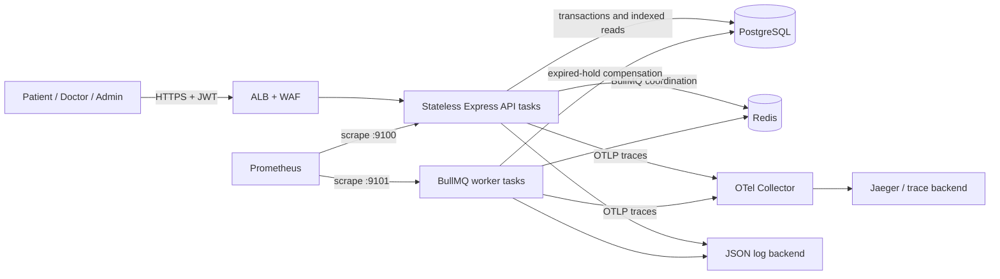
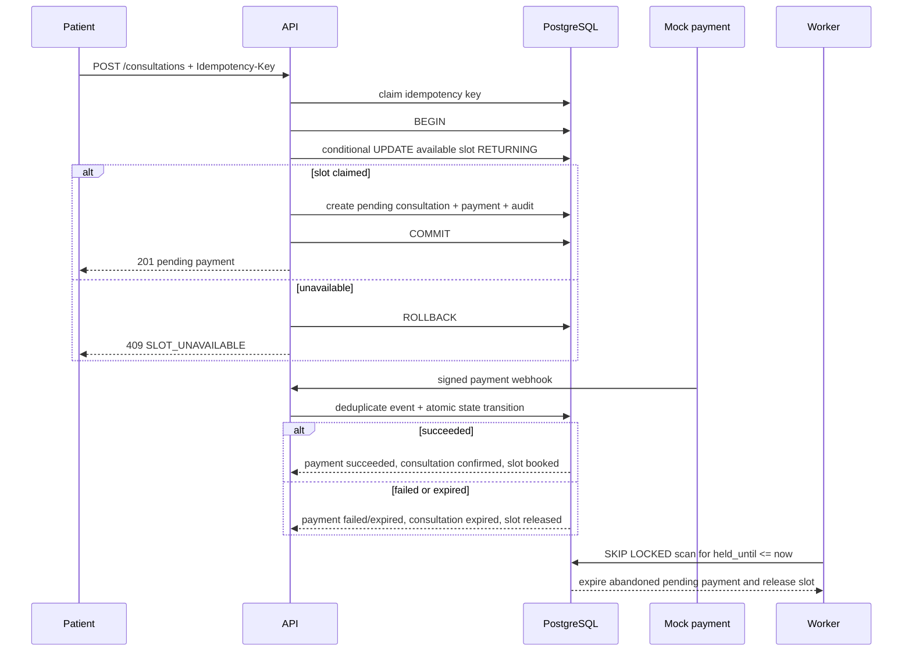
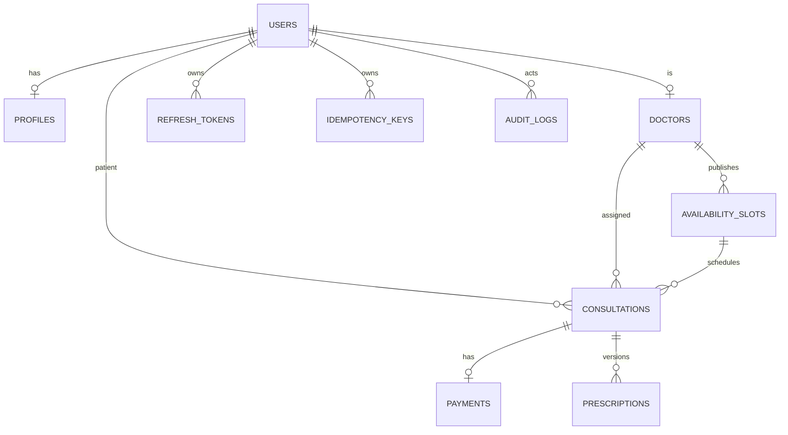

# Amrutam backend architecture

## Goals and constraints

This submission implements one production-oriented telemedicine vertical slice: authenticated user
lifecycle with doctor/admin MFA, doctor discovery and availability, an idempotent atomic booking,
mock payment confirmation or compensation, consultation lifecycle, encrypted versioned
prescriptions, audit records, and aggregate-only admin analytics. The API is stateless; PostgreSQL is
the correctness authority, Redis supports BullMQ and future distributed throttling/cache, and the
worker compensates abandoned payment holds.

The target is 100,000 consultations/day, p95 reads below 200 ms, p95 writes below 500 ms, and
99.95% availability. These are design targets, not measured claims: this repository contains no
production load-test result. Capacity must be validated in an environment that matches production.

## High-level architecture and data flow

Requests pass Helmet, CORS, request ID, PHI-safe tracing/logging, strict JSON limits, Zod validation,
authentication, RBAC/ownership, and idempotency before reaching controllers. Controllers delegate to
services; services enforce workflow rules; Prisma repositories own transactions and database
guards. Secrets and keys are injected at runtime. Prescription content, phone, DOB, and MFA secrets
are AES-256-GCM encrypted with key-version metadata.

At the reference AWS layer, public traffic terminates at an HTTPS ALB protected by WAF. API and
worker ECS Fargate tasks run in private subnets across two availability zones. RDS PostgreSQL is
encrypted, Multi-AZ, backed up, deletion-protected, and private. Redis uses encryption in transit and
at rest with automatic failover. ECR images are immutable and scanned. Secrets Manager and KMS hold
runtime configuration; CloudWatch receives encrypted logs and VPC flow logs.

## Booking flow and consistency

The booking critical section is one parameterized conditional `UPDATE ... RETURNING` inside a short
transaction. There is no correctness-critical cache and no external provider call inside the
transaction. The partial unique index on active consultations per slot is a second database guard.
Idempotency binds authenticated user, method, path, and canonical body; same-request replay returns
the stored result, key reuse with another request returns 422, and in-progress work returns 409.

Payment and cancellation are local sagas with atomic compensation. Success books the slot and
confirms the consultation. Failure, expiry, or pending cancellation releases the slot; confirmed
cancellation marks the mock payment refunded. The BullMQ worker repeats the expiry scan with
exponential retry and `FOR UPDATE SKIP LOCKED`, so multiple worker instances can coexist safely.

## Data model

UUID keys and UTC timestamps are used throughout; money is integer minor units. Important guards
include unique email, unique doctor/start slot, a PostgreSQL exclusion constraint for overlapping
availability, one active consultation per slot, unique payment provider reference, unique webhook
event ID, rotating hashed refresh tokens, and versioned prescriptions.

## API schema

The generated OpenAPI 3.1 contract is committed at `openapi/openapi.yaml` and served through Swagger
UI at `/docs` outside production. It contains exactly the 22 assignment business operations under
`/api/v1`, plus liveness/readiness documentation. Zod request contracts feed generation, and CI
performs a direct generated-artifact comparison. Stable JSON errors contain code, message, and
request ID; mutation contracts document required idempotency headers and webhook HMAC signature.

## Performance, scaling, and partitioning

100,000 consultations/day averages about 1.16 consultations/second, but daily averages hide bursts.
The reference design assumes at least a 20x peak factor and independently scales stateless API tasks
and workers. The API target group spans two availability zones; ECS CPU target tracking provides a
starting policy. RDS connection counts must be bounded per task and tested during scaling.

Reads use composite indexes for doctor filters, doctor/slot/time, patient/time, doctor/time, and
status/time. The current dataset does not require physical partitioning. At sustained scale, use
monthly range partitions for `audit_logs`, old consultations, and idempotency/webhook retention
tables; create future partitions ahead of time and detach/archive expired partitions. Keep users,
doctors, slots, active consultations, and payments unpartitioned until measured evidence justifies
change. Consider read replicas for non-transactional doctor search and aggregate analytics only.

Redis cache-aside is appropriate for verified doctor profiles and search result IDs with short TTLs
and event-driven invalidation after profile/verification changes. Never cache slot availability or
booking decisions. Use bounded pagination, select only required columns, statement timeouts,
connection pooling, and slow-query analysis. Meeting the latency objectives requires representative
load testing and database tuning; no synthetic number is asserted here.

## Retries, deployment, availability, backup, and DR

Only transient operations retry. BullMQ jobs use five attempts with exponential backoff beginning at
one second and bounded retained failures. Webhooks rely on provider retries plus event-ID
deduplication. API requests do not automatically retry non-idempotent mutations; clients may retry
with the same idempotency key. Database serialization/deadlock retry, if added, must be bounded with
jitter and must rerun the complete transaction. Permanent validation, authorization, and conflict
errors never retry.

Deploy API and worker as rolling ECS services with a deployment circuit breaker and automatic
rollback. Database migrations follow expand/migrate/contract so old and new task versions overlap
safely. Health checks separate process liveness from dependency readiness. SLO alerts should cover
availability, error rate, p95 route latency, database saturation, queue age/failures, payment
failures, and expired-hold growth.

The reference RDS policy provides Multi-AZ failover, 14-day automated backups, final snapshots, KMS
encryption, and deletion protection. Redis retains seven days of snapshots. Production should copy
RDS snapshots to a second region and store immutable audit/log archives there. Target RPO is 15
minutes and target RTO is 60 minutes for the documented regional recovery design; these targets must
be proven by quarterly restore exercises. Recovery order is network/KMS/secrets, database restore,
Redis recreation, migrations, worker, API, smoke tests, then traffic switch. A multi-region
active-active database is explicitly deferred.
