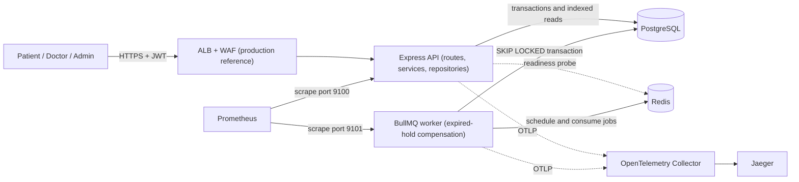
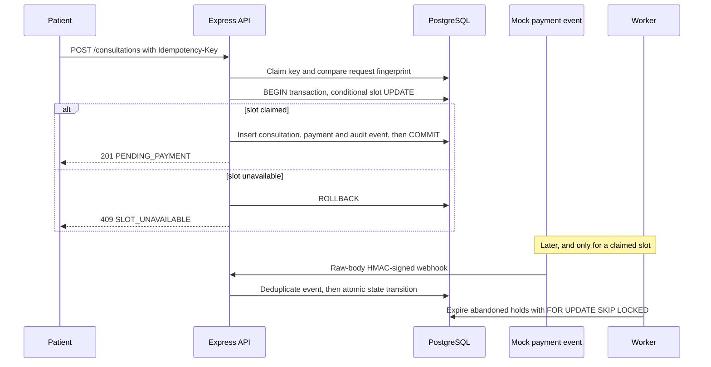
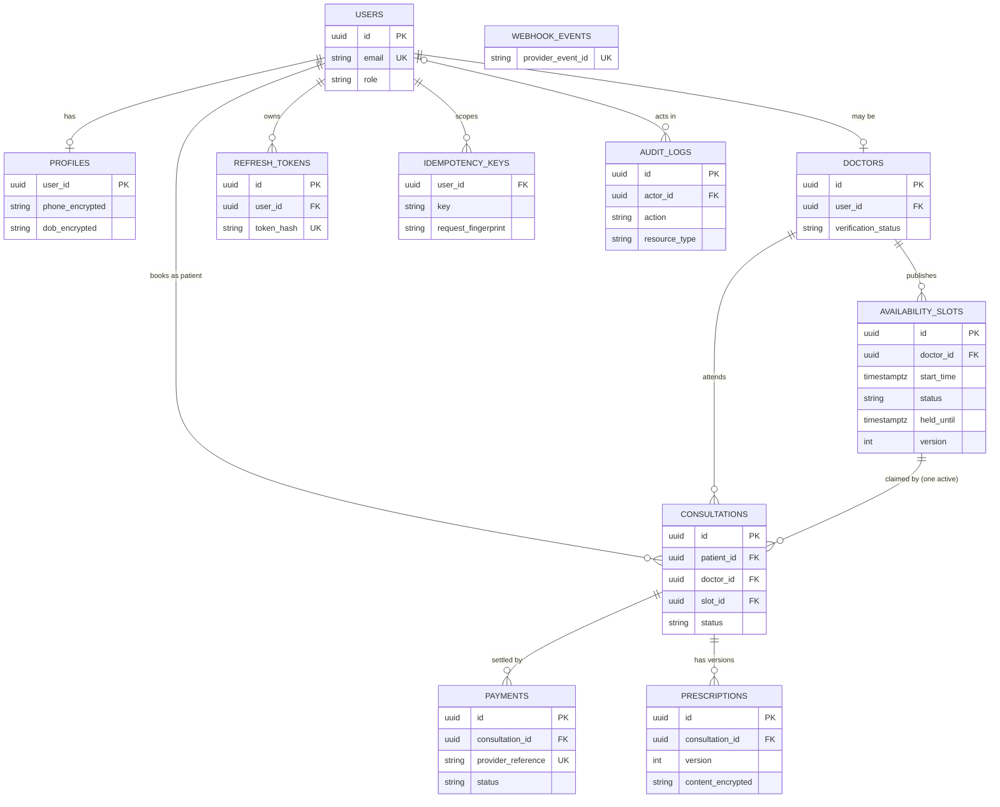

# Amrutam Telemedicine Backend

## Architecture — implementation-backed review document

> **Submission copy:** [three-page architecture brief](architecture.pdf) ·
> **Editable source:** [LaTeX](architecture.tex) · **API contract:**
> [OpenAPI 3.1](../openapi/openapi.yaml)

| Design concern        | Position                                                                    |
| --------------------- | --------------------------------------------------------------------------- |
| Application shape     | Modular Express monolith with a separately scalable BullMQ worker           |
| Correctness authority | PostgreSQL transactions, constraints, and conditional writes                |
| Asynchronous boundary | Redis-backed maintenance queue; Redis is never trusted for slot booking     |
| Security boundary     | Privileged MFA, short-lived JWTs, rotating refresh tokens, RBAC + ownership |
| Protected health data | AES-256-GCM field encryption with explicit key versions                     |
| Deployment status     | Runnable Docker Compose stack; AWS Terraform is a non-deployed reference    |

### 1. Architectural position

The system is built around one complete telemedicine journey: authenticate, discover a verified
doctor, claim a slot exactly once, settle a mock payment, conduct the consultation, and issue an
encrypted prescription. The architecture is deliberately narrow. Each component exists either to
complete that journey or to protect its security and consistency boundaries.

A **modular monolith** is the right trade-off for this release. Express provides one deployable API,
while domain modules retain clear ownership through `routes → controller → service → repository`.
Manual dependency injection in [`src/container.ts`](../src/container.ts) keeps those boundaries
visible and makes services testable without a framework-specific container. A separate worker owns
expired-hold compensation because that work has different scaling and failure characteristics from
HTTP traffic.

PostgreSQL is the source of truth for users, slots, consultations, payments, prescriptions,
idempotency records, webhook events, and audit history. Redis coordinates BullMQ jobs. It is not
consulted to decide whether a slot is available, so cache loss or stale data cannot create a
double-booking.



The API keeps authentication and workflow state outside the Node.js process. One current exception
is the authentication rate limiter, whose counters are process-local; a production rollout should
move this control to WAF or Redis before scaling API replicas.

### 2. Request path and code ownership

All requests receive a request ID and pass structured logging, metrics, tracing, Helmet, CORS, and a
strict 100 KB JSON parser. The payment webhook route additionally preserves the exact raw request
bytes so its signature can be verified before the payload is trusted. Route-specific middleware then
adds authentication, role checks, and idempotency where required. Controllers validate bounded
request contracts and translate HTTP concerns. Services own workflow and authorization decisions;
repositories own persistence and transaction boundaries.

| Layer        | Responsibility                                              | Representative implementation                                                                                                               |
| ------------ | ----------------------------------------------------------- | ------------------------------------------------------------------------------------------------------------------------------------------- |
| Routes       | URL shape and middleware order                              | [`auth-routes.ts`](../src/modules/auth/auth-routes.ts), [`booking-routes.ts`](../src/modules/consultations/booking-routes.ts)               |
| Controllers  | Validate bounded input and map service output to HTTP       | [`booking-controller.ts`](../src/modules/consultations/booking-controller.ts)                                                               |
| Services     | Workflow rules, ownership, state transitions, manual spans  | [`booking-service.ts`](../src/modules/consultations/booking-service.ts), [`payment-service.ts`](../src/modules/payments/payment-service.ts) |
| Repositories | Prisma access, parameterized SQL, constraints, transactions | [`prisma-booking-repository.ts`](../src/modules/consultations/prisma-booking-repository.ts)                                                 |
| Composition  | Manual dependency injection and environment wiring          | [`container.ts`](../src/container.ts)                                                                                                       |
| Contracts    | Bounded Zod schemas used by HTTP and OpenAPI generation     | [`src/openapi`](../src/openapi), module `*-contracts.ts` files                                                                              |

The generated OpenAPI 3.1 document contains 22 business operations and is served through Swagger UI
at `/docs` outside production. CI regenerates the document and fails if the committed artifact
drifts.

### 3. Critical consistency path: booking and payment

Booking is the system's most important race. The implementation does not read a slot and later
write it. It performs one conditional `UPDATE … RETURNING` inside a short transaction:

```sql
UPDATE availability_slots
SET status = 'HELD', held_until = $holdUntil, version = version + 1
WHERE id = $slotId AND status = 'AVAILABLE'
RETURNING id, doctor_id, start_time;
```

One returned row wins the slot. The same transaction creates the pending consultation, payment, and
audit event. Zero rows returns `409 SLOT_UNAVAILABLE`. No provider or network call runs while the
transaction is open.



Idempotency fingerprints the authenticated user, method, path, and canonical body. Repeating the
same request replays the stored response; reusing a key for different input returns `422`; concurrent
work returns `409`. Unexpected `5xx` results are abandoned rather than cached.

Payment handling is a small local saga. HMAC verification happens against the exact raw body, and
the provider event ID is unique. Success atomically marks the payment succeeded, consultation
confirmed, and slot booked. Failure or expiry marks the consultation expired and releases the slot.
Cancellation performs the matching release or mock-refund transition. The worker recovers holds
whose clients never return.

A saga with local transactions and compensations is used instead of a distributed transaction
because the payment provider is an external system that cannot join a database transaction. Every
step is guarded by the current row state, so a repeated webhook or a re-run of the worker is safe.

### 4. Data model and database invariants

The schema uses UUID identifiers, UTC timestamps, integer minor units for money, foreign keys, and
indexes aligned with the public queries. Application checks improve error messages; database guards
remain the final defence against races or future code regressions.

| Boundary               | Database guard                                                                |
| ---------------------- | ----------------------------------------------------------------------------- |
| Identity               | Case-insensitive unique email                                                 |
| Doctor availability    | Unique doctor/start time plus GiST exclusion constraint for overlapping slots |
| Booking                | Conditional slot update plus partial unique index for one active consultation |
| Payment/webhook        | Unique provider reference and unique provider event ID                        |
| Refresh-token rotation | Unique token hash and linked replacement token                                |
| Prescription history   | Unique consultation/version pair                                              |
| Idempotent mutation    | Unique authenticated user/key pair with request fingerprint                   |

The principal relationships are `User → Profile`, `User → Doctor`, `Doctor → AvailabilitySlot`, and
`Consultation → Payment / Prescription versions`. Audit records reference the actor and resource but
store safe metadata only. The diagram below shows the entities and the columns that carry
constraints; the complete model and custom PostgreSQL constraints are in
[`prisma/schema.prisma`](../prisma/schema.prisma) and the
[`initial migration`](../prisma/migrations/202610270001_initial_schema/migration.sql).



### 5. Concurrency, caching, and retry strategy

**Concurrency control.** Each hazard has one authoritative guard in PostgreSQL, so correctness does
not depend on application timing or on Redis.

| Hazard                                        | Control                                                                  |
| --------------------------------------------- | ------------------------------------------------------------------------ |
| Two patients claim the same slot              | Single conditional `UPDATE … RETURNING`; partial unique index as backstop |
| Overlapping or duplicate doctor slots         | Unique doctor/start time plus GiST exclusion constraint                  |
| Client retries a write                        | Idempotency record unique per user and key, with request fingerprint     |
| Duplicate or replayed payment webhook         | Unique provider event ID and unique provider reference                   |
| Concurrent refresh-token use                  | Transactional rotation, unique token hash, family revoked on reuse       |
| Several workers expire the same hold          | `FOR UPDATE SKIP LOCKED` and state-guarded updates                       |
| Stale writer on a slot row                    | `version` column incremented on every slot update                        |

Transactions stay short and make no external calls while open.

**Caching.** Correctness never depends on a cache: booking and slot availability always read and
write PostgreSQL. In this release reads are served directly from indexed PostgreSQL queries. The
planned read-scaling layer is short-lived cache-aside in Redis for verified doctor profiles and
search-result IDs, using TTLs with jitter and a version in the key so that doctor or slot changes
invalidate by bumping the version instead of scanning keys. If Redis is unavailable the read path
falls back to PostgreSQL.

**Retry and backoff.** Retries are safe because every mutation is idempotent or state-guarded.

| Caller or component            | Strategy                                                                                                                                   |
| ------------------------------ | ------------------------------------------------------------------------------------------------------------------------------------------ |
| API client, timeout or `5xx`   | Retry the same `Idempotency-Key` with exponential backoff and jitter (for example 0.5 s, 1 s, 2 s, capped, bounded attempts)               |
| API client, `409` in progress  | Wait briefly and retry with the same key; never generate a new key for the same intent                                                    |
| API client, `409 SLOT_UNAVAILABLE` | Do not retry; choose another slot                                                                                                      |
| API client, `422` or other `4xx` | Do not retry; the request itself must change                                                                                            |
| API client, `429`              | Back off and retry later, honouring `Retry-After` when present                                                                             |
| Payment webhook delivery       | The provider redelivers on non-2xx; the handler deduplicates on the unique event ID, so redelivery is harmless                            |
| Expired-hold worker            | Eligibility is decided from PostgreSQL rows and updates are state-guarded, so a failed or crashed run is simply repeated on the next scan |
| Real payment provider (extension) | Timeout, bounded retries with exponential backoff and full jitter only when the provider accepts an idempotency key, plus a circuit breaker; never inside a database transaction |
| Worker jobs (extension)        | Bounded BullMQ attempts with exponential backoff and jitter, and an alert on failed or dead-lettered jobs                                  |

### 6. Data partitioning

All tables are currently unpartitioned and served by indexes aligned with the public queries; at the
design target this is the simpler and safer choice. Partitioning is a planned lever, not an
implemented feature, and it has a specific constraint here: in PostgreSQL, primary-key and unique
constraints on a partitioned table must include the partition key, and exclusion constraints cannot
span partitions. Partitioning `availability_slots` or `consultations` would therefore weaken or
force a redesign of the GiST overlap guard and the partial unique index that protect against
double-booking.

The intended order is:

1. **Append-only audit history first.** Monthly range partitions on `created_at` need no cross-row
   uniqueness beyond the identifier, and old partitions can be detached for retention or archival.
2. **Consultations next, only when volume justifies it.** Range partition by scheduled month after
   re-expressing the active-consultation uniqueness to include the partition key; the atomic slot
   claim remains the primary booking authority.
3. **Slots last.** Keep them unpartitioned for as long as the exclusion constraint is required.

Automated partition creation and retention jobs are deliberate extensions.

### 7. Security and privacy boundaries

Authentication, authorization, encryption, and audit are independent layers; possession of a valid
token alone is not enough to read clinical data.

| Boundary          | Implemented control                                                                                   |
| ----------------- | ----------------------------------------------------------------------------------------------------- |
| Credentials       | Argon2id passwords; recovery codes and opaque refresh tokens stored only as hashes                    |
| Sessions          | Short-lived RS256 access JWTs; transactional refresh-token rotation and family revocation on reuse    |
| Privileged access | TOTP MFA for doctors and administrators                                                               |
| Authorization     | Route-level roles plus patient ownership and assigned-doctor checks in services                       |
| Protected fields  | AES-256-GCM for phone, DOB, MFA secret, and prescription content; random IV and key-version metadata  |
| Payment ingress   | Raw-body HMAC-SHA256 verification, timing-safe comparison, event deduplication                        |
| Input surface     | Strict bounded Zod schemas, unknown-field rejection, JSON limit, Helmet, CORS, and auth rate limiting |
| Accountability    | Request-linked audit events without tokens, contact information, or prescription text                 |

Patients can read only their consultations and prescriptions. Doctors can access only assigned
consultations. Administrators receive aggregate analytics and cannot read prescription content.
Logs, metrics, traces, and audit metadata exclude request bodies, credentials, and clinical text.
The full data classification, STRIDE/OWASP analysis, and key-rotation procedure live in
[`docs/security.md`](security.md).

### 8. Operations, observability, and deployment

Docker Compose starts the API, worker, PostgreSQL, and Redis. Its observability profile adds the
OpenTelemetry Collector, Prometheus, and Jaeger. API and worker containers run read-only with
`no-new-privileges`; Swagger and the payment simulator are disabled in production.

- **Logs:** Pino JSON records request ID, normalized route, status, and duration. HTTP logs do not
  serialize headers or bodies.
- **Metrics:** Prometheus captures request count/duration and bounded booking, payment, and
  expired-hold outcomes on dedicated ports.
- **Traces:** Manual HTTP and booking/payment spans combine with Prisma and Redis instrumentation and
  export over OTLP.
- **Health:** liveness is separated from PostgreSQL/Redis readiness so orchestration can distinguish
  a live process from a usable instance.

The AWS Terraform is a **reviewable reference, not a deployed environment**. It models an HTTPS ALB
and WAF; private subnets across two availability zones for ECS Fargate API and worker services;
encrypted Multi-AZ RDS PostgreSQL; encrypted ElastiCache Redis; immutable ECR images; KMS; Secrets
Manager; CloudWatch; and API autoscaling. Runtime secrets are intentionally not committed or
materialized by Terraform.

### 9. Backup and disaster recovery

**Targets:** 15-minute recovery point objective (RPO) and 60-minute recovery time objective (RTO).
These are design targets; no restore has been exercised in this repository.

| State                           | Recovery approach                                                                                                                      |
| ------------------------------- | -------------------------------------------------------------------------------------------------------------------------------------- |
| PostgreSQL (authoritative)      | Multi-AZ failover for in-zone failure; automated backups with point-in-time recovery for corruption or operator error; encrypted snapshots |
| Redis (BullMQ queue only)       | Treated as rebuildable. It holds no booking, payment, or audit state, and hold eligibility is decided from PostgreSQL rows, so expiry resumes once Redis and the worker return |
| Compute (API, worker)           | Stateless; redeployed from immutable ECR images and Terraform                                                                          |
| Secrets and encryption keys     | Held in the secret store. A restored database is unreadable without the matching field-encryption key versions, so key custody is part of the DR plan |

**Restore procedure (point-in-time recovery):**

1. Declare the incident and stop writes by scaling the API down or routing to a maintenance response.
2. Restore PostgreSQL to a new instance at the chosen point in time.
3. Verify: migrations table, row counts on core tables, and constraints and indexes present.
4. Point the API and worker secrets at the restored instance and confirm `/health/ready`.
5. Reconcile in-flight work: the worker expires stale holds, and the payment provider's webhook
   redelivery is deduplicated by event ID.
6. Resume traffic, then record the actual RPO and RTO achieved.

Cross-region snapshot copy and an active-standby region are extensions, not part of this release.

### 10. Scaling model and explicit limits

**Targets from the brief:** 100,000 consultations per day, 99.95% availability (about 22 minutes of
monthly error budget), p95 below 200 ms for reads and below 500 ms for writes. These are targets,
not measured results.

The design target of 100,000 consultations per day averages only about 1.16 consultations per
second, which is not a meaningful capacity result by itself. As a planning assumption, a peak factor
of 10–15× implies roughly 12–17 bookings per second, with reads outnumbering writes many times over.
Booking races, login bursts, payment callbacks, query mix, and database connection pressure
determine the real limit. No latency or throughput benchmark is claimed in this repository.

The API and worker can scale independently, and `FOR UPDATE SKIP LOCKED` lets several workers share
expiry work. Composite indexes support doctor discovery and time/status queries. Correctness-critical
writes remain on the primary database. Read replicas may later serve doctor search and aggregate
analytics; short-lived cache-aside is suitable for verified doctor profiles and search-result IDs.
Slot availability and booking decisions must never be cached.

Known production work is stated plainly:

- replace the process-local authentication limiter with a distributed/WAF-backed control;
- set and load-test an explicit Prisma connection budget per task;
- tune the worker's current 100-row expiry batch and scan interval against backlog objectives;
- add lifecycle cleanup for expired idempotency and webhook records;
- prove backup restore, key rotation, autoscaling, and the 15-minute RPO / 60-minute RTO targets in
  section 9;
- implement partitioning (section 6) only when audit and retention table size justifies the
  operational cost.

Real payment/video providers, active-active regions, automated partition management, and a global
tamper-evident audit chain are deliberate extensions, not represented as finished features.

### 11. Engineering proof

The CI pipeline runs formatting, linting, strict type checking, unit and integration tests, OpenAPI
drift detection, application and Docker builds, dependency audit, full-history secret scanning,
container vulnerability scanning, and Terraform/Checkov validation.

| Evidence                       | Source                                                                                       |
| ------------------------------ | -------------------------------------------------------------------------------------------- |
| Clean-clone setup and commands | [`README.md`](../README.md)                                                                  |
| API contract and Swagger flow  | [`openapi/openapi.yaml`](../openapi/openapi.yaml), [`src/app.ts`](../src/app.ts)             |
| Core risk tests                | [`tests/unit`](../tests/unit), [`tests/integration`](../tests/integration)                   |
| Runtime topology               | [`docker-compose.yml`](../docker-compose.yml), [`Dockerfile`](../Dockerfile)                 |
| Telemetry configuration        | [`observability`](../observability), [`src/infra/observability`](../src/infra/observability) |
| AWS reference architecture     | [`infra/terraform`](../infra/terraform)                                                      |
| Delivery pipeline              | [`.github/workflows/ci.yml`](../.github/workflows/ci.yml)                                    |
| Rehearsed end-to-end evidence  | [`docs/rehearsal.md`](rehearsal.md), [`docs/demo-script.md`](demo-script.md)                 |